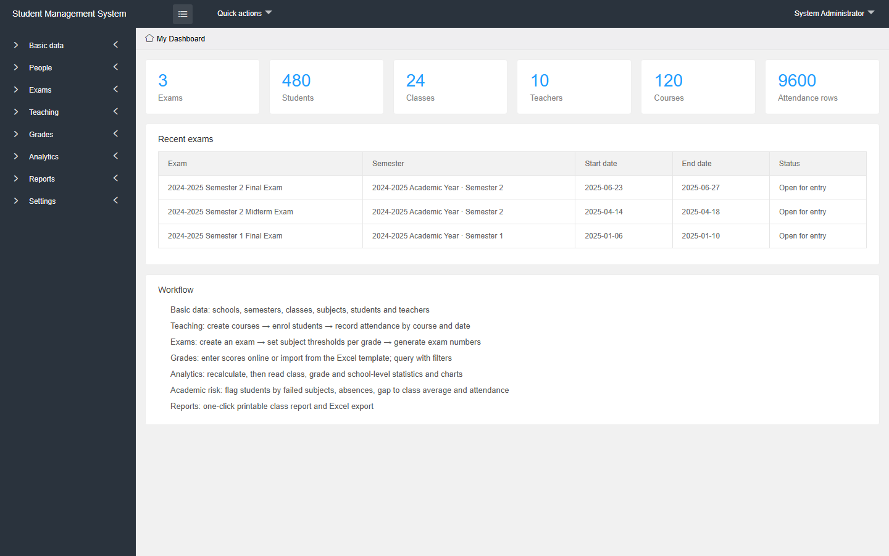
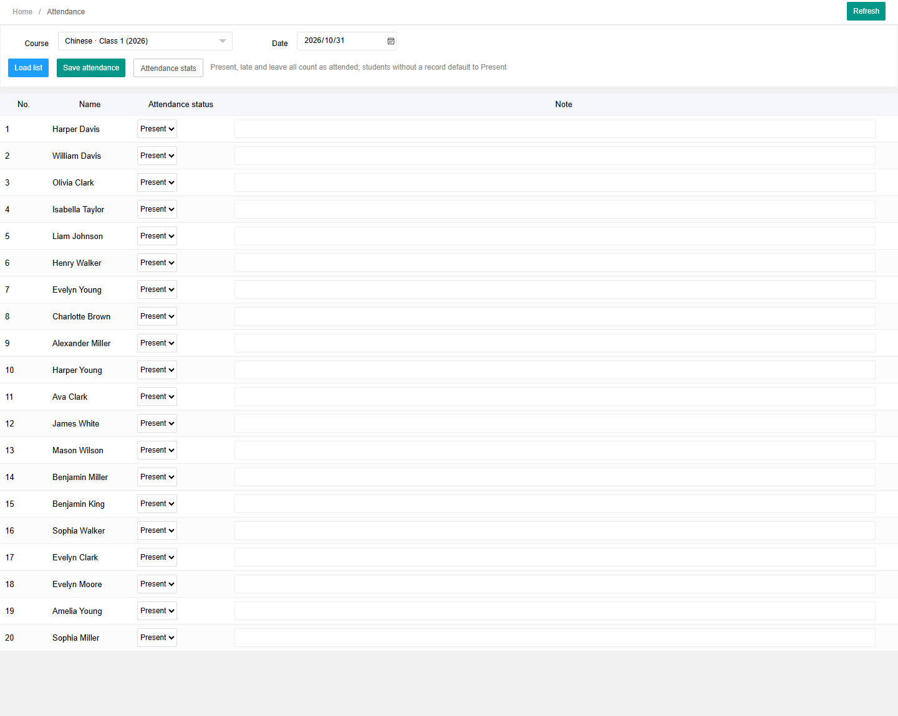
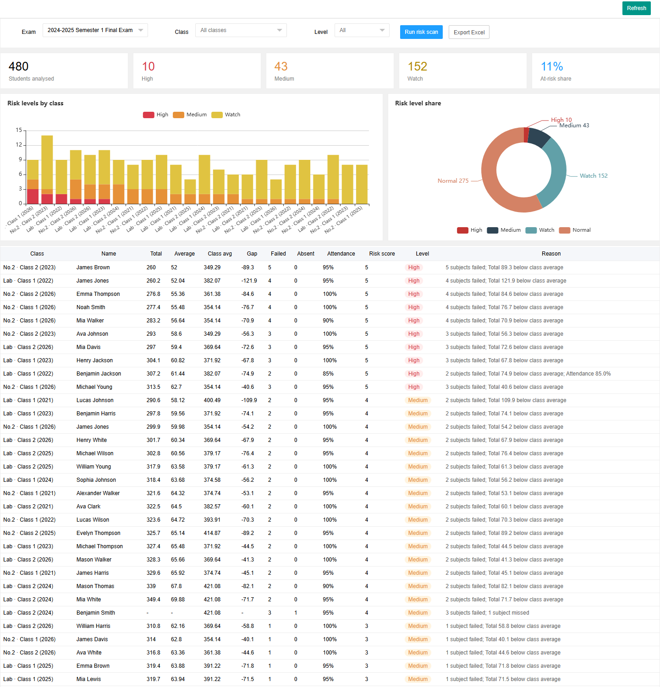
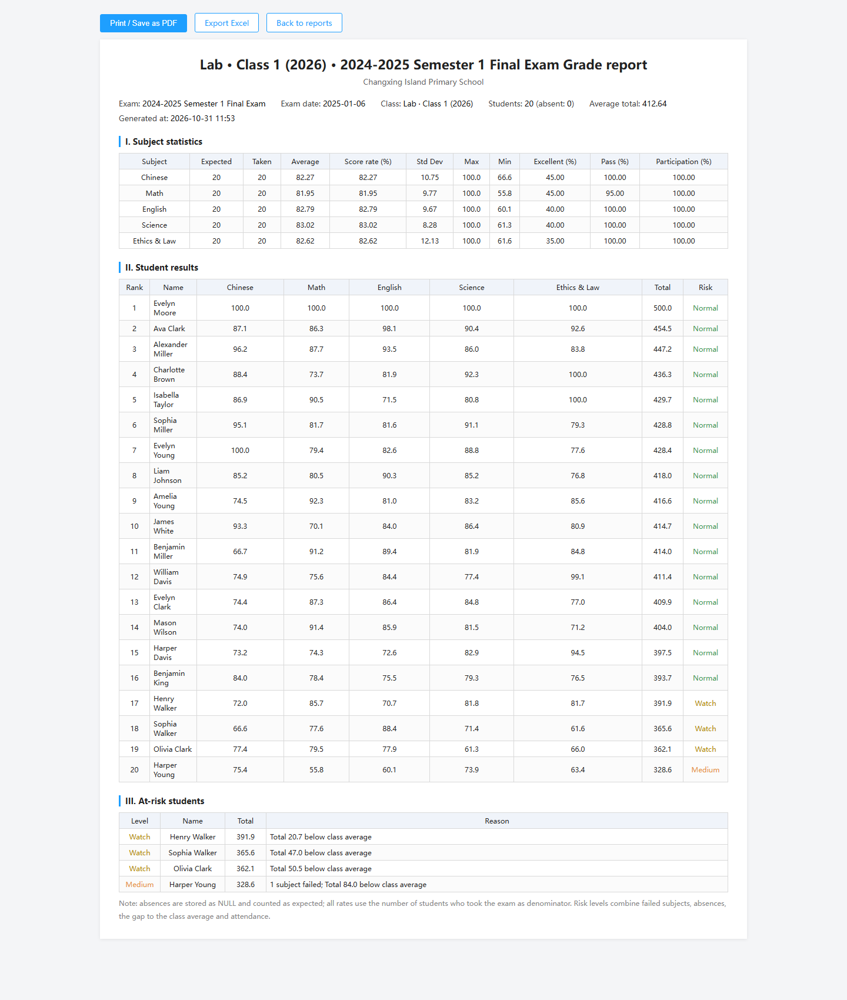

# Design and Development of a Web-Based Student Management System with Role-Based Access Control and Academic Performance Analytics

> 学生管理系统 · 学生档案、选课、考勤与成绩一体化平台

一套面向中小学与区县教研部门的学生管理系统：把学生档案、选课、考勤与成绩统一到一个平台，
用关系数据库 + 基于角色的访问控制保证数据准确、安全、实时可见，并按考试自动生成班级与年级报表；
内置学业预警看板，帮助教师提前发现学习风险学生。

后端 **FastAPI + SQLAlchemy 2.0 + SQLite + Jinja2**，前端 X-admin 2.2 + layui + ECharts。
单进程启动、零外部服务依赖，克隆后装依赖 + 灌演示数据即可跑通全流程。

| 研究目标 | 在系统中的落点 |
| --- | --- |
| ① 支持多角色的学生注册、选课、考勤与成绩管理 | 学生档案（`/student`）、课程（`/course`）、选课（`/enrollment`）、考勤（`/attendance`）、成绩录入与查询（`/luru`、`/chengji`） |
| ② 关系数据库 + RBAC + 自动报表，保证准确/安全/实时 | 26 张表 + 数据视图白名单（`services/permission.py`）、`auth_rule/auth_group` 角色-权限、一键生成班级/全校报表（`/report`） |
| ③ 以可用性、性能与减负效果为指标做用户评估 | 18 项接口性能基准（`seed/bench.py`）、SUS 可用性问卷与任务脚本（`docs/evaluation.md`） |



## 功能

| 模块 | 说明 |
| --- | --- |
| 学生档案 | 学生、班级、年级、学校、学期、学科、教师、登录用户与类别字典，配置驱动的通用 CRUD |
| 课程管理 | 按「学期 + 班级 + 学科 + 任课教师」开设课程，维护课时与任课关系 |
| 选课管理 | 学生与课程的选修关系，支持单条维护与「按班级批量选课」 |
| 考勤管理 | 按「课程 + 日期」整班录入出勤状态（出勤/迟到/请假/缺勤），整批保存、重复保存覆盖，并给出按日与按人的到课率 |
| 考试与考号 | 新建考试、设置各学科分数线，批量生成考号并打印准考证 |
| 成绩管理 | 在线矩阵录入（空=缺考、0=零分）、采集表下载、Excel 导入导出、多条件查询 |
| 统计分析 | 班级 / 年级 / 全校三级统计 40+ 指标，平均分对比、优秀率及格率、分数段分布三张图 |
| 学业预警 | 规则可解释的风险评分（不及格科目、缺考、与班级均分差距、到课率），输出高/中/关注/正常四级名单与原因 |
| 报表中心 | 班级成绩报表（可打印/另存 PDF）、单班 Excel、一场考试全部班级批量 Excel |
| 学生端 | 学生用身份证号登录，查看本人历次成绩与趋势 |

### 考勤与预警





### 成绩报表



## 角色与访问控制（RBAC）

登录身份分两类实体（管理员/教师共用 `admin` 表，学生独立），权限由三条链路叠加：

1. **角色-规则**：`auth_rule`（菜单与接口规则）+ `auth_group`（角色）+ `auth_group_access`（用户-角色），
   菜单与 URL 校验都读同一份规则（`services/permission.py::user_rule_ids / check_url`）。
2. **数据范围**：`my_quanxian()` 计算可见班级 → `data_scope()` 展开成
   `{banji_ids, nj_keys, ruxuenians}` 三级白名单，各接口把白名单注入查询条件，而不是在控制器里硬过滤。
3. **业务边界**：课程/考勤/预警/报表的每个接口都校验「该班级是否在本人范围内」，越权返回 `无权查看`。

| 角色 | 判定方式 | 数据范围 |
| --- | --- | --- |
| 超级管理员 | `Auth.administrator` | 全部 |
| 校长 / 教学副校长 / 教学主任 | 职务 `10701/10703/10705` | 本校全部班级 |
| 班主任 | 现任班主任记录（`ban_zhu_ren`） | 所带班级 |
| 任课教师 | 当前学期任课分工（`fen_gong`） | 所教班级 |
| 学生 | `student` 表登录 | 仅本人 |

## 数据与统计口径

所有指标集中在 `app/services/stats.py`，三级统计复用同一套口径：

- **缺考**用 `defen IS NULL` 严格区分，`0 分`计入实考；除参试率外，所有比率的分母都是**实考人数**
- **标准差**为样本标准差（除以 n−1），样本不足 2 个时返回空而不是除零
- **中位数**偶数个取中间两数平均；**四分位**用 (n−1) 线性插值
- **排名**支持并列同名次：`rank` 仅在值变化时跳号，`weizhi = (n − rank)/(n − 1) × 100`
- **标准分** `Z = (x − 全区均分) / 全区标准差`
- **总分**作为伪学科 `subject_id = 0` 参与统计；缺考任意一科则该生总分记缺考
- 三级统计**各自从成绩表独立全量重算**，不层层汇总，任一级别补录不会污染其他级别

## 快速开始

环境：Python 3.10+（实测 3.12 / 3.13）。

```bash
# 1. 安装依赖
pip install -r requirements.txt

# 2. 生成演示数据（含课程、选课、考勤、三级统计、排名、标准分）
python -m seed.seed --reset

# 3. 启动
python run.py
# 浏览器打开 http://127.0.0.1:8000
```

演示账号（密码统一 `123456`）：

> 界面与演示数据均为英文（English UI），下列角色名即界面中的显示名。

| 身份 | 账号 | 数据范围 |
| --- | --- | --- |
| 系统管理员 | `admin` | 全部（2 所学校 / 24 个班） |
| 教学副校长 | `xiaozhang` | 职务 10703 → 本校全部班级 |
| 普通教师 | `wanglaoshi` | 仅本校所教班级（12 / 24 个班） |
| 学生 | 身份证号，如 `210278200606087012` | 仅本人成绩 |

演示数据规模：2 所学校 / 24 个班 / 480 名学生 / 10 名教师 / 120 门课程 / 2400 条选课 /
9600 条考勤 / 3 场考试 / 7200 条成绩，SQLite 库约 1.6 MB。

## 目录结构

```text
app/
  core/       config · database · security（PBKDF2 + 签名 cookie）· deps · response
  models/     SQLAlchemy 模型，26 张表（含 course / enrollment / attendance）
  services/   stats 统计算法 · tongji 三级统计 · permission 数据权限（RBAC）
              risk 学业预警 · kaohao 考号 · chengji_io 导入导出 · crud · menu · serialize
  routers/    auth · page · generic（配置驱动 CRUD）· api_base · api_kaoshi
              api_chengji · api_tongji · api_teaching · api_risk · report · portal
  templates/  Jinja2 页面（X-admin 骨架 + 通用列表/表单 + 可打印报表）
  static/     X-admin 2.2 / layui / ECharts
seed/         seed.py 演示数据 · check*.py 自检 · bench.py 性能基准
docs/         项目范围说明 · 评估方案 · 截图
data/cj.db    SQLite 数据库（首次运行生成，不入库）
```

结构相似的模块由配置驱动：`app/registry.py` 用声明式字段描述模块的列表列、表单字段与搜索条件，
`routers/generic.py` 据此生成页面与增删改查接口。新增一张字典表只需加一段配置。

## 自检

启动服务后运行：

```bash
python seed/check.py           # 40 项端到端：页面 · 统计交叉验算 · 权限 · 学生端 · 图表
python seed/check_teaching.py  # 34 项：课程 · 选课 · 考勤 · 学业预警 · 报表 · 角色权限
python seed/check_crud.py      # 通用 CRUD：新增 → 列表 → 编辑 → 删除
python seed/check_io.py        # 考号生成幂等 + Excel 导出导入往返
python seed/check_pages.py     # 28 个页面渲染冒烟（无异常、无未渲染模板）
```

当前全部通过：`check 40/40`、`check_teaching 34/34`、`check_pages 28/28`、`check_crud 0 失败`、`check_io 往返一致`。

## 性能基准

`python -m seed.bench` 对 9 个主要接口做 10~30 次采样（本机 SQLite、单进程 uvicorn）：

| 接口 | P50 | P95 | 响应 |
| --- | --- | --- | --- |
| GET /healthz | 1 ms | 2 ms | 0.0 KB |
| GET /welcome | 3 ms | 5 ms | 3.0 KB |
| POST /api/student/list | 2 ms | 3 ms | 2.0 KB |
| POST /api/tongji/bj_list | 4 ms | 5 ms | 8.0 KB |
| POST /api/tongji/chart | 5 ms | 6 ms | 3.7 KB |
| POST /api/risk/list（480 名学生全量预警） | 31 ms | 69 ms | 121 KB |
| POST /api/risk/chart | 24 ms | 62 ms | 1.0 KB |
| GET /report/banji（可打印报表） | 12 ms | 13 ms | 12 KB |
| GET /api/report/all.xlsx（24 个班批量报表） | 316 ms | 360 ms | 55 KB |

## 评估方案

可用性、性能与减负效果的评价方法、任务脚本与问卷见 [`docs/evaluation.md`](docs/evaluation.md)；
研究目标与实现的逐条对应见 [`docs/project-scope.md`](docs/project-scope.md)。

## 开发约定

- 时间统一用整数 unix 时间戳存，展示层转换；删除一律软删除（`delete_time`）
- 接口两种响应格式：业务 `{"val":1|0,"msg","data"}`，表格 `{"code":0,"count","data":[]}`
- 会话用签名 cookie 承载，密码 PBKDF2-SHA256 加盐存储；签名密钥优先读环境变量 `CJ_SECRET_KEY`，
  未设置时首次启动自动生成到 `data/.secret_key`（已在 .gitignore 中）

## 第三方开源资源

`app/static/` 下的前端资源为第三方开源项目，版权归各自作者，按各自许可证使用：

| 资源 | 位置 | 许可 |
| --- | --- | --- |
| X-admin 2.2 后台模板 | `app/static/x-admin2.2/` | 见项目原仓库 |
| layui | `app/static/x-admin2.2/lib/layui/` | MIT |
| Apache ECharts | `app/static/x-admin2.2/js/echarts/` | Apache-2.0 |
| jQuery | `app/static/x-admin2.2/js/jquery.min.js` | MIT |

其中 `js/echarts/echarts.js` 原本是一份适配 layui 模块加载的定制构建（浏览器里不会生成全局
`echarts`，页面直接 `echarts.init()` 会报错），已把 UMD 头改回标准全局加载方式，其余代码未改动。

本仓库自有代码（`app/`、`seed/`、`run.py` 等）为本项目团队独立设计与实现。
演示数据（学校、班级、学生、成绩、身份证号）全部由 `seed/seed.py` 随机生成，与任何真实个人无关。
